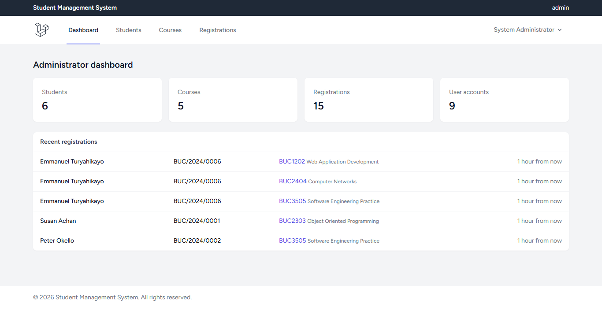
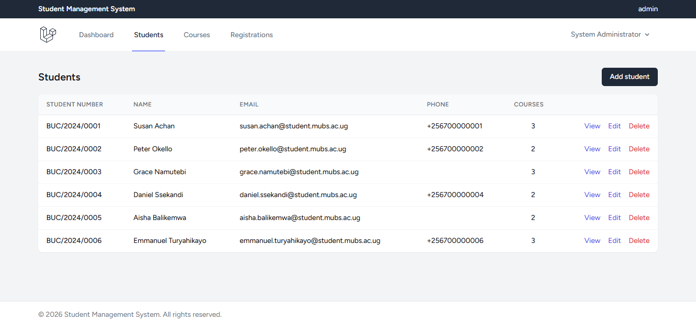
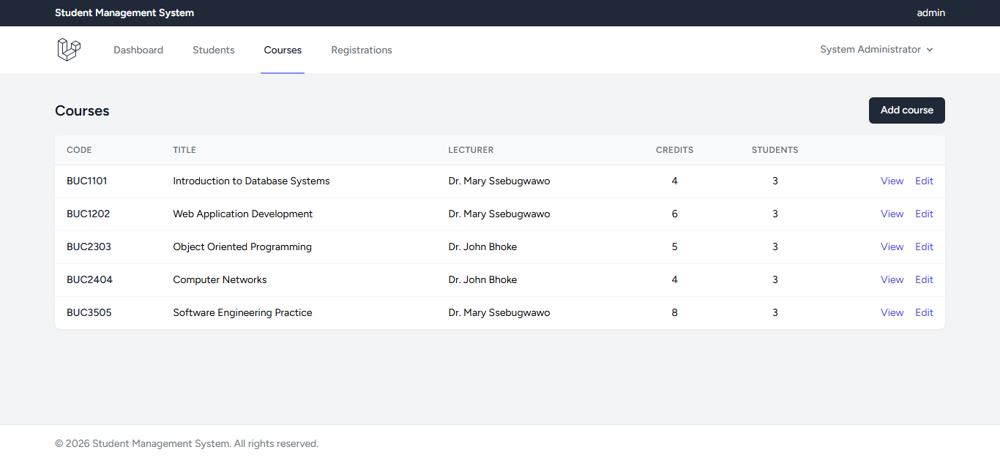
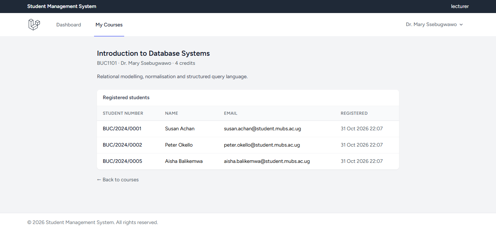
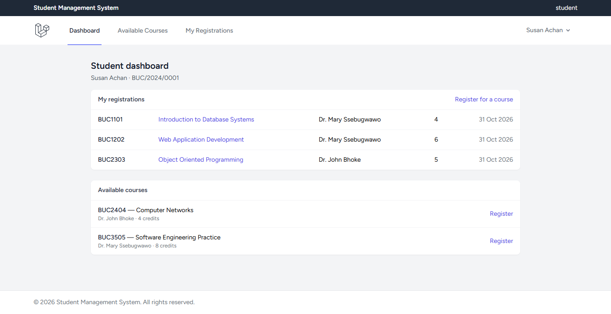
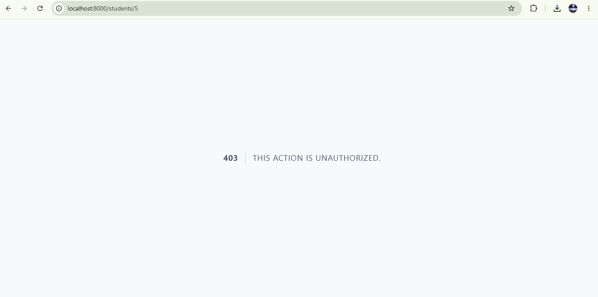

# Student Management System (BUC3131 Coursework Two)

A web system for a university that keeps records of students, courses, lecturers and course
registrations. Three kinds of user see three different sets of pages: an **administrator** manages
everything, a **lecturer** reads the courses assigned to them and the students on them, a **student**
looks at the courses they have not taken yet, registers for them and cancels their own registrations.

Built by five students on `https://github.com/davidworks256/universityproject`.

| Part | What is used |
|---|---|
| Framework | Laravel 12 (PHP 8.2) |
| Database | MySQL or MariaDB (tests run on SQLite in memory) |
| Authentication | Laravel Breeze, Blade stack |
| Roles and permissions | `spatie/laravel-permission` 6 |
| Front end | Blade views, Tailwind CSS 3, Alpine.js, Vite |
| Tests | Pest 3 (121 tests) |

## 1. Installing it

You need PHP 8.2 or newer, Composer, Node.js and a MySQL or MariaDB server.

```bash
git clone https://github.com/davidworks256/universityproject.git sms
cd sms
composer install
cp .env.example .env
php artisan key:generate
```

## 2. Database setup

Create an empty database called `sms` and make sure the `DB_*` lines in `.env` match your server.
The defaults in `.env.example` are what the team used with XAMPP:

```dotenv
DB_CONNECTION=mariadb
DB_HOST=127.0.0.1
DB_PORT=3306
DB_DATABASE=sms
DB_USERNAME=root
DB_PASSWORD=
```

Then build the tables, fill them with the sample data and build the CSS and JavaScript:

```bash
php artisan migrate:fresh --seed
npm install
npm run build
php artisan serve
```

Open <http://localhost:8000>. `composer setup` runs the steps above as one command, but it migrates
without seeding, so run `php artisan db:seed` after it. `composer dev` starts the server, the queue, the
log reader and Vite together for development.

`php artisan db:seed` can be run as many times as you like: every seeder uses `firstOrCreate`,
`syncRoles` or `syncWithoutDetaching`, so a second run adds nothing.

## 3. Roles and what each one may do

Roles are `admin`, `lecturer` and `student`. The permissions are `manage students`, `manage courses`,
`manage registrations`, `manage users`, `view assigned courses`, `view course students`,
`view available courses`, `view own registrations` and `register for course`. Routes are guarded by
the `permission:` middleware declared in `routes/web.php`; single records are guarded by the three
policies in `app/Policies`.

| Role | May do |
|---|---|
| Administrator | add, change and delete students, courses and registrations; open any record; cancel any registration |
| Lecturer | read the courses where they are the assigned lecturer, and the students registered on them; change nothing |
| Student | read the available courses, register for one, cancel their own registration, open their own student record |

The rules a marker can test in five minutes: a lecturer opening a course assigned to somebody else
gets 403, a student opening another student's record gets 403, a student cancelling another student's
registration gets 403, and registering for the same course twice is refused first by the code and
then by the unique index on `course_registrations`.

## 4. Sample logins

Every seeded account uses the password `password`. These come from `php artisan db:seed`.

| Role | Email |
|---|---|
| Administrator | `admin@example.com` |
| Lecturer | `lecturer@example.com` (Dr. Mary Ssebugwawo) |
| Lecturer | `lecturer2@example.com` (Dr. John Bhoke) |
| Student | `susan.achan@student.mubs.ac.ug` (BUC/2024/0001) |
| Student | `peter.okello@student.mubs.ac.ug` (BUC/2024/0002) |
| Student | `grace.namutebi@student.mubs.ac.ug` (BUC/2024/0003) |
| Student | `daniel.ssekandi@student.mubs.ac.ug` (BUC/2024/0004) |
| Student | `aisha.balikemwa@student.mubs.ac.ug` (BUC/2024/0005) |
| Student | `emmanuel.turyahikayo@student.mubs.ac.ug` (BUC/2024/0006) |

The sample data is six students, five courses (`BUC1101`, `BUC1202`, `BUC2303`, `BUC2404`, `BUC3505`)
and fifteen registrations, two or three courses per student.

Accounts made with the sign-up form are given the `student` role, and a student added on
**Students → Add student** also gets a login, with the same email address and the password `password`.

## 5. The data model

| Table | Columns |
|---|---|
| `users` | `id`, `name`, `email`, `password`, timestamps; roles come from Spatie's own tables |
| `students` | `id`, `user_id` → `users` (delete cascades), `student_number` (unique), `name`, `email` (unique), `phone` nullable, timestamps |
| `courses` | `id`, `code` (unique), `title`, `description` nullable, `credits`, `lecturer_id` → `users` nullable (set to null on delete), timestamps |
| `course_registrations` | `id`, `student_id` → `students` (cascade), `course_id` → `courses` (cascade), `registered_at`, timestamps, **unique (`student_id`, `course_id`)** |

Relationships: `User` hasOne `Student` and hasMany `Course` as `taughtCourses`; `Student` belongsTo
`User` and belongsToMany `Course`; `Course` belongsTo `User` as `lecturer` and belongsToMany
`Student`. Both many-to-many pairs go through `course_registrations` and carry `registered_at`.

## 6. Where the code is

```
app/Http/Controllers    StudentController, CourseController, RegistrationController, DashboardController
app/Http/Requests       five form requests: student and course store/update, registration store
app/Policies            StudentPolicy, CoursePolicy, RegistrationPolicy
app/Models              Student, Course, CourseRegistration, User
database/migrations     the four tables above plus the Breeze and Spatie tables
database/seeders        RolesAndPermissionsSeeder, UserSeeder, StudentSeeder, CourseSeeder, RegistrationSeeder
resources/views         layouts/app.blade.php, partials/nav.blade.php, students/, courses/, registrations/, dashboard/
routes/web.php          the resource routes and their middleware
tests/Feature           one file per area, 121 tests
```

## 7. Running the tests

```bash
php artisan test
```

The suite uses an in-memory SQLite database, so no MySQL server is needed to run it. Format the PHP
with `vendor/bin/pint` before committing.

## 8. Screenshots

Taken from the running application after `php artisan migrate:fresh --seed`. `docs/screenshots/README.md`
says which account and page each one came from.

**Administrator** (`admin@example.com`) — the dashboard with the record counts and the latest
registrations, the student list, and the course list:





**Lecturer** (`lecturer@example.com`) — a course assigned to that lecturer, with the students registered
on it. The same page opened by a lecturer it is not assigned to returns 403:



**Student** (`susan.achan@student.mubs.ac.ug`) — her own registrations with the courses still open to her,
and the refusal when she types another student's record into the address bar:




## 9. How the work was split

See `CONTRIBUTIONS.md` for the members, the branches, the pull requests and which question each piece
answers. `WORK_ORDER.md` explains the order the pieces were merged in and why that order was chosen.
